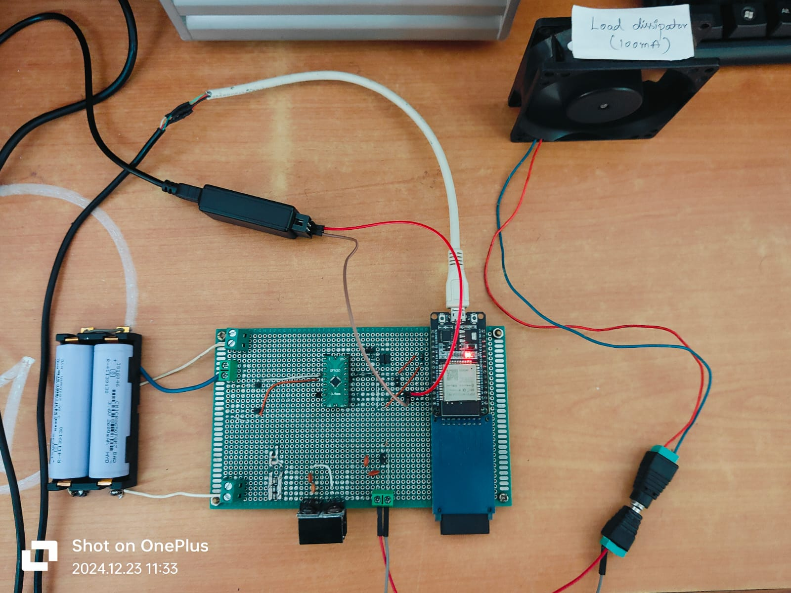
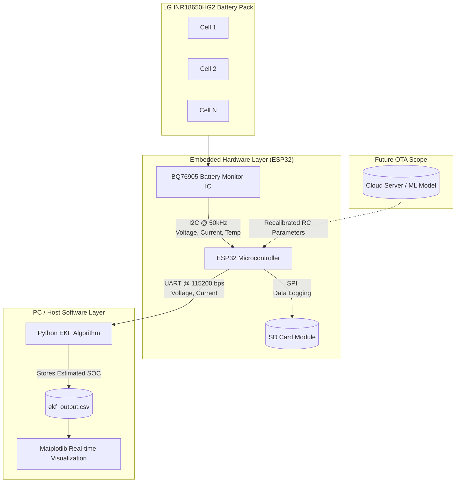
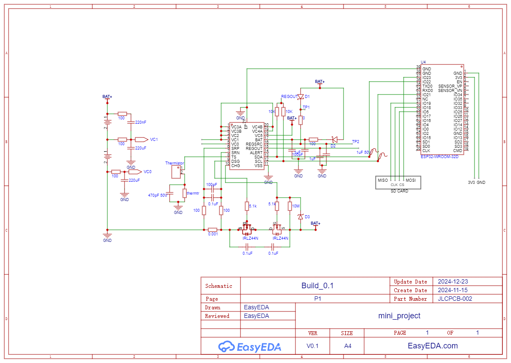
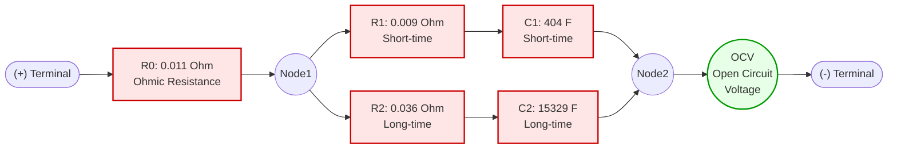
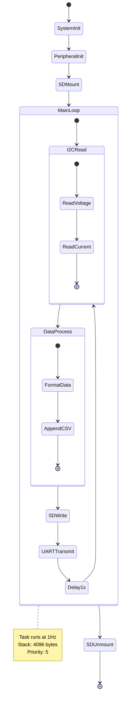
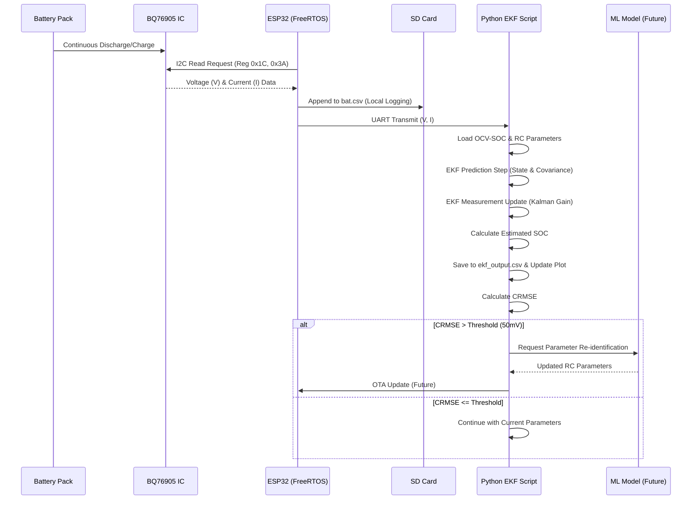
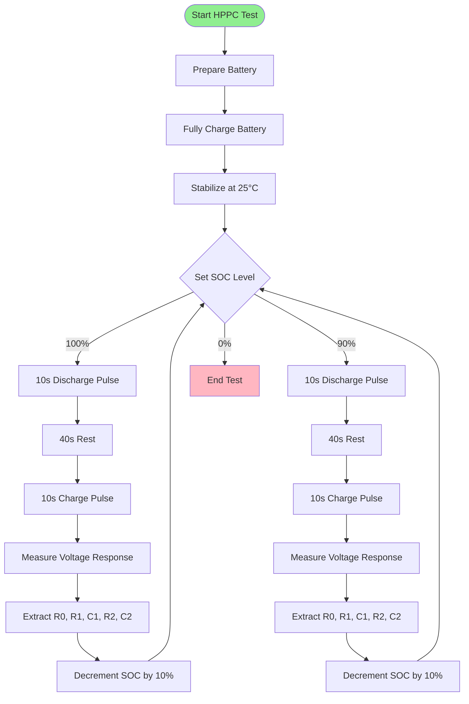
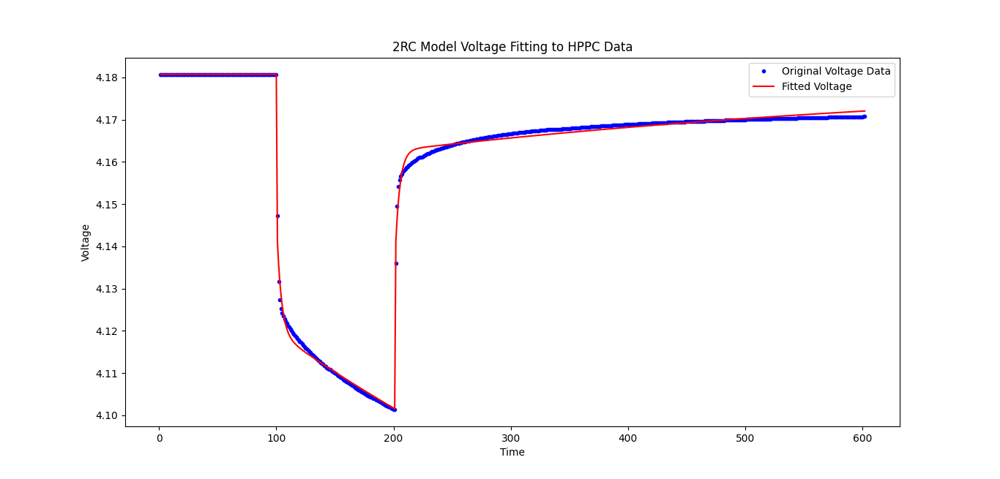
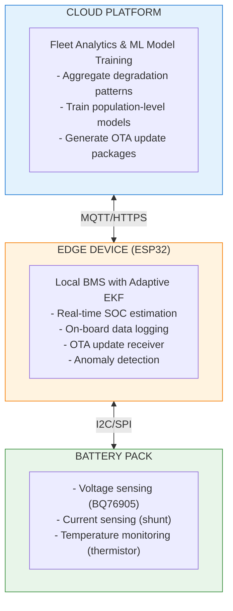
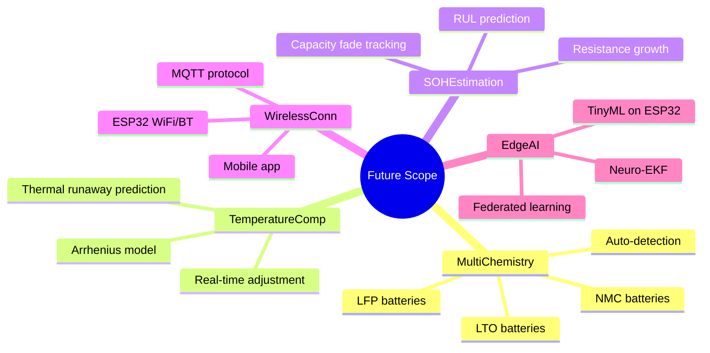

# Advanced SOC Estimation for Lithium-Ion Batteries using Data-Driven Modeling with AEKF



[](https://www.espressif.com/en/products/modules/esp32)
[](https://docs.espressif.com/projects/esp-idf/en/latest/)
[]()
[]()

## Table of Contents

- [Overview](#overview)
- [Problem Statement & Objectives](#problem-statement--objectives)
- [System Architecture](#system-architecture)
- [Hardware Design & Circuitry](#hardware-design--circuitry)
- [Software Implementation](#software-implementation)
- [Methodology & Working Principle](#methodology--working-principle)
- [Tools & Technologies](#tools--technologies)
- [Project Outcomes & Results](#project-outcomes--results)
- [Use Cases & Industry Relevance](#use-cases--industry-relevance)
- [Future Scope](#future-scope)
- [Repository Structure](#repository-structure)
- [Installation & Setup](#installation--setup)
- [Team & Acknowledgments](#team--acknowledgments)
- [References](#references)

---

## Overview

This project presents an advanced State of Charge (SOC) estimation system for lithium-ion batteries that combines data-driven modeling with Adaptive Extended Kalman Filters (AEKF). The system addresses the critical challenge of maintaining accurate SOC estimation as batteries age and their characteristics change due to temperature variations, cycling, and operational conditions.

Traditional Kalman filter-based methods rely on static battery models that become inaccurate over time. This solution leverages historical degradation data and machine learning techniques to dynamically recalibrate battery model parameters, enabling the EKF to maintain high accuracy throughout the battery's lifecycle. This approach is highly relevant for Industry 4.0 applications where IoT-enabled Battery Management Systems (BMS) can receive Over-The-Air (OTA) updates to adapt to individual battery characteristics.

---

## Problem Statement & Objectives

### Problem Statement
Traditional Kalman filter-based SOC estimation methods face challenges in maintaining accuracy as battery characteristics change over time due to aging, temperature variations, and operational conditions. Static models struggle to adapt dynamically to evolving battery behaviors, leading to inaccurate SOC estimates that can compromise safety and efficiency.

### Objectives
- Develop a model that adapts to changing battery characteristics over time, such as aging and temperature variations.
- Ensure the model operates effectively in real-time scenarios, providing instant SOC estimates.
- Reduce errors and discrepancies in SOC estimation compared to traditional static methods.
- Validate the performance of the model through extensive testing and comparison with existing methods.

---

## System Architecture



---

## Hardware Design & Circuitry

### Core Components

#### 1. BQ76905 Battery Monitor IC
- **Function:** Multi-cell battery monitoring and protection.
- **Key Features:** Up to 5-series cell monitoring, integrated current sensing with shunt resistor, I2C communication interface, built-in ADC, and hardware protection (OVP, UVP, OCP, SCP).
- **Register Configuration:** 
  - Voltage measurement: `0x1C`
  - Current measurement: `0x3A`
  - FET control: `0x3E`
  - I2C Address: `0x08`

#### 2. ESP32 Microcontroller (ESP32-WROOM-32D)
- **Specifications:** Dual-core 32-bit LX6 processor @ 240 MHz, 520 KB SRAM, integrated Wi-Fi + Bluetooth.
- **Pin Configuration (from `main.c`):**
  - **SPI (SD Card):** MISO (19), MOSI (23), CLK (18), CS (5)
  - **UART (PC):** TX (17), RX (16)
  - **I2C (BQ76905):** SDA (21), SCL (22)

### Hardware Schematic

The physical circuit design was developed based on the BQ76905 datasheet recommendations, ensuring proper decoupling, pull-up resistors, and protection mechanisms.


*(Figure: Complete hardware schematic showing BQ76905 interfacing with ESP32, SD card, and battery pack)*

### 2RC Equivalent Circuit Model

The battery is modeled using a 2RC (two resistor-capacitor) network to simulate dynamic behavior.



**Obtained Parameters (from HPPC test at 25°C):**
- **R0:** 0.011047 Ω (Ohmic resistance)
- **R1:** 0.009323 Ω, **C1:** 404.550961 F (Short-time transient)
- **R2:** 0.035821 Ω, **C2:** 15328.908 F (Long-time transient)

---

## Software Implementation

### Firmware Architecture (ESP-IDF + FreeRTOS)

The firmware is written in C using the ESP-IDF framework. It utilizes FreeRTOS for task management, ensuring deterministic execution of sensor reading, data logging, and communication tasks.



**Key Firmware Features:**
- **I2C Master Driver:** Custom implementation to read 16-bit registers from BQ76905, handling start/stop conditions and ACK/NACK.
- **FAT Filesystem:** Integration with `esp_vfs_fat` to mount the SD card and append voltage/current data to `bat.csv` in real-time.
- **UART Communication:** Configured at 115200 baud rate to stream comma-separated voltage and current data to the host PC.

### Python EKF Implementation

The host-side software is written in Python, utilizing `PySerial` for data acquisition and `NumPy`/`Pandas` for matrix operations and data handling.

**Extended Kalman Filter Algorithm:**
- **State Vector:** `x = [SOC, V_RC1, V_RC2]`
- **State Prediction:** Uses Coulomb counting for SOC and exponential decay for RC voltages.
- **Measurement Update:** Calculates Kalman Gain to correct the state estimate based on the terminal voltage measurement and the OCV-SOC lookup table.



---

## Methodology & Working Principle

### 1. Battery Characterization (HPPC Test)

The Hybrid Pulse Power Characterization (HPPC) test is performed to extract battery model parameters.



### 2. Real-Time SOC Estimation & Adaptive Recalibration

The system continuously monitors the Corrected Root Mean Squared Error (CRMSE) between the measured terminal voltage and the model-predicted voltage. If the CRMSE exceeds a predefined threshold (e.g., 50mV), it indicates battery aging or parameter drift. The system then triggers a recalibration process using the stored historical discharge data on the SD card to update the RC parameters via gradient descent optimization.

---

## Tools & Technologies

### Hardware Tools
| Tool | Purpose |
|------|---------|
| Lab Bench Power Supply | Battery charging/discharging, HPPC testing |
| Digital Oscilloscope | Signal integrity verification, transient analysis |
| Logic Analyzer | I2C/SPI/UART protocol debugging |
| Multimeter | Voltage/current validation |

### Embedded Development
| Technology | Version/Details |
|------------|-----------------|
| ESP-IDF | v5.x (Espressif IoT Development Framework) |
| FreeRTOS | Integrated with ESP-IDF for task scheduling |
| C/C++ | Firmware development |
| CMake | Build system |
| Espressif-IDE | VS Code-based IDE |

### Communication Protocols
| Protocol | Configuration | Use Case |
|----------|---------------|----------|
| I2C | 50 kHz, 7-bit addressing | BQ76905 sensor communication |
| SPI | 4-wire, 20 MHz | SD card data logging |
| UART | 115200 bps, 8N1 | PC communication |

### Software & Libraries (Python)
| Library | Purpose |
|---------|---------|
| NumPy | Matrix operations, linear algebra |
| Pandas | Data manipulation, CSV handling |
| Matplotlib | Real-time visualization, plotting |
| SciPy | Optimization, curve fitting |
| PySerial | Serial communication with ESP32 |

---

## Project Outcomes & Results

### HPPC Test Results
Successfully characterized LG INR18650HG2 battery at 25°C:

| Parameter | Value | Unit |
|-----------|-------|------|
| **R0** (Ohmic resistance) | 0.011047 | Ω |
| **R1** (Short-time RC) | 0.009323 | Ω |
| **C1** | 404.550961 | F |
| **R2** (Long-time RC) | 0.035821 | Ω |
| **C2** | 15328.908 | F |
| **Nominal Capacity** | 3.0 | Ah |

**Model Fitting Validation:**
The extracted parameters were validated against the actual HPPC discharge data to ensure the 2RC model accurately represents the battery's dynamic voltage response.

 
*(Figure: 2RC Model Voltage Fitting to HPPC Data, demonstrating the close match between the estimated model and actual battery response)*

### Model Validation & Adaptive Recalibration Impact

| Scenario | CRMSE | SOC Error |
|----------|-------|-----------|
| Fresh battery (calibrated) | 19mV | < 2% |
| Aged battery (no update) | 110mV | ~8% |
| Aged battery (recalibrated) | 19mV | < 2% |

**Improvement:** 82.7% reduction in estimation error after recalibration.

### System Performance
| Metric | Value |
|--------|-------|
| Sampling rate | 1 Hz (configurable) |
| UART latency | < 10ms |
| SD card write speed | ~50 KB/s |
| ESP32 CPU usage | ~15% (single core) |

---

## Use Cases & Industry Relevance

### Primary Applications
1. **Electric Vehicles (EVs):** OTA updates recalibrate BMS parameters based on individual usage patterns, extending range accuracy and improving safety.
2. **Renewable Energy Storage:** Site-specific parameter adaptation using historical cycling data for accurate grid balancing.
3. **Portable Electronics:** Personalized SOC estimation that adapts to user-specific discharge patterns, reducing unexpected shutdowns.
4. **Medical Devices:** Redundant SOC estimation with continuous self-calibration for critical life-support equipment.

### Industry 4.0 Integration



### Competitive Advantages
| Feature | Traditional BMS | Our Solution |
|---------|-----------------|--------------|
| SOC Accuracy | 5-10% error | <2% error |
| Adaptability | Fixed parameters | OTA updates |
| Aging Compensation | Manual recalibration | Automatic |
| Data Logging | Limited | SD card + cloud |
| Cost | High (ASIC-based) | Low (ESP32) |

---

## Future Scope



**Long-Term Vision:**
- **Edge AI Integration:** Deploy TinyML models on ESP32 for on-device parameter estimation.
- **Hardware-in-the-Loop (HIL) Testing:** Real-time battery emulator for algorithm validation.
- **Standardization:** ISO 26262 compliance for automotive applications.
- **Blockchain:** Immutable degradation history for battery passports and second-life valuation.

---

## Repository Structure

```text
SOC_estimation_repo/
│
├── Drivers/                        # ESP-IDF Firmware Project
│   ├── main/
│   │   └── main.c                  # Main firmware (I2C, UART, SD card)
│   ├── components/                 # Custom ESP-IDF components
│   ├── managed_components/         # ESP Registry components (SSD1306)
│   ├── CMakeLists.txt              # Build configuration
│   ├── sdkconfig                   # ESP-IDF project configuration
│   └── build/                      # Compiled binaries
│
├── src/                            # Python Source Code
│   └── extended_kf.py              # EKF algorithm + visualization
│   └── generate_input.py           # Data simulation and plotting script
│
├── sample_datasets_used/           # Battery Characterization Data
│   ├── OCV--25degC--549_C20DisCh.csv
│   ├── CellParams--25degC--551_Mixed1.csv
│   └── 00001.csv
│
├── Schematic/                      # Hardware Design Files
│   └── Initial_draft.png           # Circuit schematic (EasyEDA)
│
├── Mini_Project_Content_Pages.pdf  # Academic Report
├── README.md                       # This file
└── .gitignore                      # Git ignore rules
```

---

## Installation & Setup

### Prerequisites
- ESP32 development board (ESP32-WROOM-32D)
- BQ76905 evaluation module or custom PCB
- SD card module (SPI interface)
- USB-to-UART bridge (if not integrated)
- LG INR18650HG2 battery cells (or compatible)

### Firmware Setup (ESP-IDF)

```bash
# 1. Install ESP-IDF (Linux/macOS)
git clone -b v5.0 https://github.com/espressif/esp-idf.git
cd esp-idf
./install.sh
./export.sh

# 2. Clone project
cd ~/projects
git clone <repository-url>
cd SOC_estimation_repo/Drivers

# 3. Configure project
idf.py menuconfig
# Set: Serial flasher config -> Default serial port (/dev/ttyUSB0 or COM6)

# 4. Build and flash
idf.py build
idf.py -p /dev/ttyUSB0 flash
idf.py -p /dev/ttyUSB0 monitor
```

### Python Environment Setup

```bash
# 1. Create virtual environment
python -m venv venv
source venv/bin/activate  # Linux/macOS
# or
venv\Scripts\activate     # Windows

# 2. Install dependencies
pip install numpy pandas matplotlib scipy pyserial

# 3. Run EKF algorithm
cd src
python extended_kf.py
```

---

## Team & Acknowledgments

**Project Developed By:**
- Chethan R
- Kushaal S M
- Likith S
- Pratik Ukey

**Institution:** Sai Vidya Institute of Technology (SVIT), Bengaluru  
**Department:** Electronics and Communication Engineering  
**Academic Year:** 2024-2025

---

## References

### Academic Papers
1. **Venugopal et al.**, "Analysis of Optimal Machine Learning Approach for Battery Life Estimation of Li-Ion Cell," *IEEE Access*, vol. 9, 2021. DOI: 10.1109/ACCESS.2021.3130994
2. **Kumar et al.**, "Advances in Batteries, Battery Modeling, Battery Management System, Battery Thermal Management, SOC, SOH, and Charge/Discharge Characteristics in EV Applications," *IEEE Access*, vol. 11, 2023. DOI: 10.1109/ACCESS.2023.3318121
3. **Vidal et al.**, "Machine Learning Applied to Electrified Vehicle Battery State of Charge and State of Health Estimation: State-of-the-Art," *IEEE Access*, vol. 8, 2020. DOI: 10.1109/ACCESS.2020.2980961
4. **Zhang et al.**, "State-of-charge estimation of lithium-ion battery pack by using an adaptive extended Kalman filter for electric vehicles," *Journal of Energy Storage*, vol. 37, May 2021. DOI: 10.1016/j.est.2021.102457
5. **Kim et al.**, "Adaptive Battery State-of-Charge Estimation Method for Electric Vehicle Battery Management System," *IEEE ISOCC 2020*. DOI: 10.1109/ISOCC50952.2020.9332950
6. **Sepasi et al.**, "A novel on-board state-of-charge estimation method for aged Li-ion batteries based on model adaptive extended Kalman filter," *Journal of Power Sources*, vol. 245, 2014. DOI: 10.1016/j.jpowsour.2013.06.101

### Datasets & Datasheets
7. **LG INR18650HG2 Dataset**, Nature Scientific Data, 2024. URL: https://www.nature.com/articles/s41597-024-03831-x
8. **Texas Instruments**, "BQ76905 3- to 5-Series Battery Monitor Datasheet," 2023. URL: https://www.ti.com/product/BQ76905
9. **Espressif Systems**, "ESP32-WROOM-32D Datasheet," 2024. URL: https://www.espressif.com/en/products/modules/esp32

---

## License

This project is open-source and available under the MIT License.

```text
MIT License

Copyright (c) 2024 Sai Vidya Institute of Technology

Permission is hereby granted, free of charge, to any person obtaining a copy
of this software and associated documentation files (the "Software"), to deal
in the Software without restriction, including without limitation the rights
to use, copy, modify, merge, publish, distribute, sublicense, and/or sell
copies of the Software, and to permit persons to whom the Software is
furnished to do so, subject to the following conditions:

The above copyright notice and this permission notice shall be included in all
copies or substantial portions of the Software.

THE SOFTWARE IS PROVIDED "AS IS", WITHOUT WARRANTY OF ANY KIND, EXPRESS OR
IMPLIED, INCLUDING BUT NOT LIMITED TO THE WARRANTIES OF MERCHANTABILITY,
FITNESS FOR A PARTICULAR PURPOSE AND NONINFRINGEMENT. IN NO EVENT SHALL THE
AUTHORS OR COPYRIGHT HOLDERS BE LIABLE FOR ANY CLAIM, DAMAGES OR OTHER
LIABILITY, WHETHER IN AN ACTION OF CONTRACT, TORT OR OTHERWISE, ARISING FROM,
OUT OF OR IN CONNECTION WITH THE SOFTWARE OR THE USE OR OTHER DEALINGS IN THE
SOFTWARE.
```
